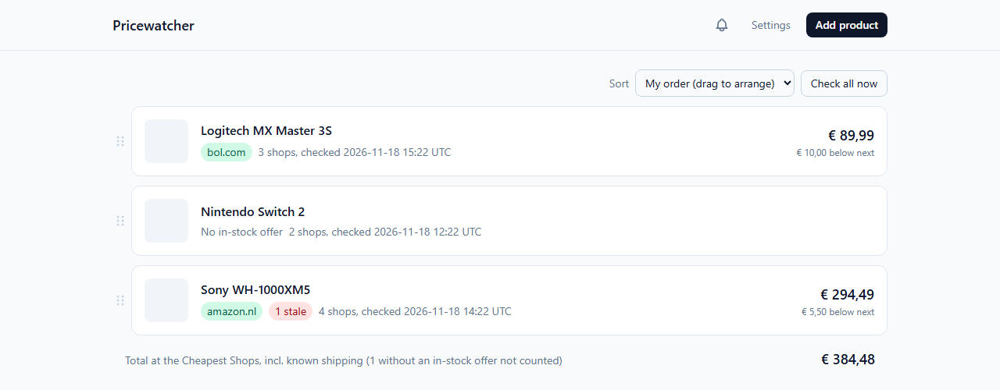
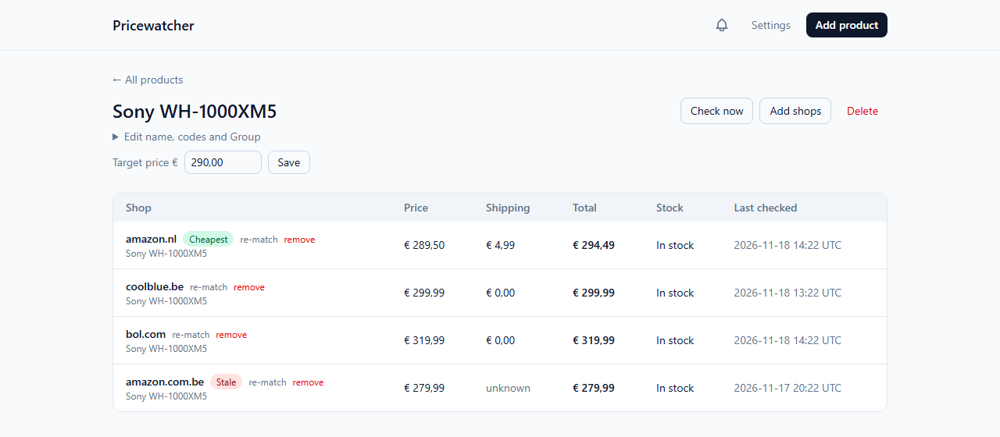

# Pricewatcher

**Stop refreshing six webshops before Black Friday.** Pricewatcher is a small self-hosted price tracker for
Belgian and Dutch webshops. Add the things on your wishlist once, and it checks every shop for you, shows
where each one is cheapest right now (shipping included), and pings you on Telegram when a price drops below your
target or hits an all-time low. Handy for Black Friday, Cyber Monday and Christmas shopping, or for that TV
you've been eyeing for months.





- One row per Product with its Cheapest Shop; click through for every Shop's price and the price history.
- Target Price and all-time-low alerts on Telegram, without repeats when prices bounce.
- A bell in the header with recent price changes.
- Group Products (e.g. "Christmas gifts") and drag them into your own order.
- Runs on your own server: one container or LXC, a SQLite file, no account, no cloud, no tracking.

Shops: amazon.nl, amazon.com.be, bol.com, coolblue.be, mediamarkt.be, vandenborre.be, alternate.be.
Prices are in EUR. Adding a Shop is one small Python file, see [CONTRIBUTING.md](CONTRIBUTING.md).

> **Security:** Pricewatcher has no login. Anyone who can reach port 8000 can see and change everything, so keep it
> on your LAN, or put it behind a reverse proxy with authentication or a VPN such as Tailscale.

## Install on Proxmox VE

Run this in a shell on the Proxmox host:

```sh
bash -c "$(curl -fsSL https://raw.githubusercontent.com/modbase/pricewatcher/main/proxmox/pricewatcher.sh)"
```

It asks whether to use the default settings (an unprivileged Debian 13 container with 2 cores, 2 GB RAM, 8 GB
disk, DHCP on `vmbr0`) or to change them under Advanced, then installs Pricewatcher as a systemd service and prints
its URL. Without a terminal it skips the questions; variables in front of the command set the defaults either way,
for example `CTID=150 STORAGE=local-zfs VLAN=50 bash -c "$(curl ...)"`. See the top of
[`proxmox/pricewatcher.sh`](proxmox/pricewatcher.sh) for all of them.

To update, run `update` in the container's console, or run the install command again with `CTID` set to the
existing container. Your data in `/opt/pricewatcher/data` and your `/opt/pricewatcher/.env` are kept.

## Install with Docker Compose

Get [`docker-compose.yml`](docker-compose.yml) into an empty directory and run:

```sh
docker compose pull && docker compose up -d
```

Open `http://<server>:8000`. Everything is stored in `./data/pricewatcher.db`. Run exactly one container: price
checks run inside the app process. To update, run the same command again. To build the image yourself instead:
`docker compose up -d --build`.

## Using it

Add a Product (name, plus an EAN or model number if you have one, for better matches), pick the matching result
for each Shop, and you're done. Prices are rechecked once per check interval (6 hours unless changed on the Settings
page). To check right away, use **Check now** on a Product's page or **Check all now** on the overview; the check
runs in the background, so reload the page after a minute.

The Settings page (top right) sets the check interval, quiet hours without scheduled checks, how many failed checks
make a Listing stale, and whether and when all-time-low alerts fire. They are stored in the database.

Quiet hours use the timezone in the `TZ` environment variable (default `Europe/Brussels`). The Proxmox install uses
the host's timezone.

## Telegram alerts

Create a bot with [@BotFather](https://t.me/BotFather), send it a message, and find your chat id (for example with
[@userinfobot](https://t.me/userinfobot)). Enter the bot token and chat id on the Settings page and send a test
message from there.

You can also set them as the environment variables `TELEGRAM_BOT_TOKEN` and `TELEGRAM_CHAT_ID`, which override the
Settings page: in a `.env` file next to `docker-compose.yml` for Docker, or in `/opt/pricewatcher/.env` on Proxmox
(then `systemctl restart pricewatcher`). Without a token and chat id, alerts are only logged.

## Moving your data

To move to another server, copy the database with SQLite's backup API (safe while the app runs) and put it in the
new install's data directory **before its first start**:

```sh
python -c "import sqlite3; d = sqlite3.connect('pricewatcher-backup.db'); sqlite3.connect('data/pricewatcher.db').backup(d); d.close()"
```

The app only creates missing tables on start, so it keeps your Products, Shops and price history. Stop the old
install afterwards, or both will check the same Shops.

## Development

```sh
python -m venv .venv
.venv/Scripts/pip install -r requirements-dev.txt   # .venv/bin/pip on Linux and macOS
.venv/Scripts/python -m playwright install chromium
.venv/Scripts/uvicorn app.main:app --reload
```

Open http://127.0.0.1:8000. The database is `data/pricewatcher.db` (override with `PRICEWATCHER_DB`).
Tests: `.venv/Scripts/python -m pytest -q` (no network; Shop pages are saved fixtures).
Design and decisions: [`PLAN.md`](PLAN.md). Terms: [`GLOSSARY.md`](GLOSSARY.md).

## License

[MIT](LICENSE)
